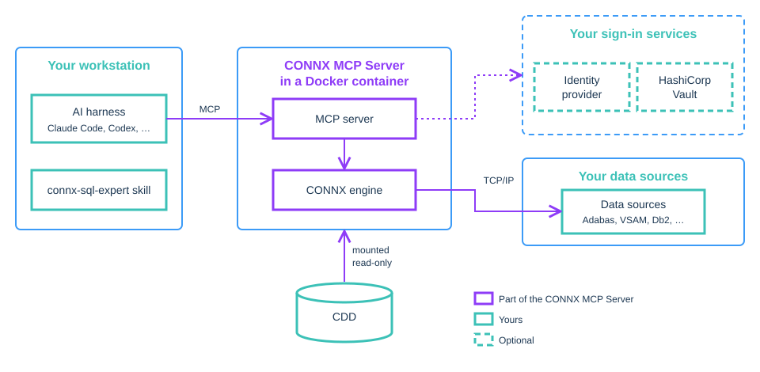

<!--
CONNX MCP Server Community Edition: what it is, how a harness uses it, what you need and the first steps.

Copyright:
    Copyright 2026 Software GmbH
    Licensed under the Apache License, Version 2.0 (the "License"); you may not use this file except in compliance
    with the License. You may obtain a copy of the License at https://www.apache.org/licenses/LICENSE-2.0
    Unless required by applicable law or agreed to in writing, software distributed under the License is distributed
    on an "AS IS" BASIS, WITHOUT WARRANTIES OR CONDITIONS OF ANY KIND, either express or implied. See the License
    for the specific language governing permissions and limitations under the License.
-->

# CONNX MCP Server Community Edition

The CONNX MCP Server lets AI applications read your CONNX SQL data. It gives read-only access to the CONNX catalog
and to SQL queries through the Model Context Protocol (MCP).

## What the server is

The CONNX MCP Server Community Edition is a Linux container image for the amd64 (x86-64) architecture. The
container holds the MCP server and the CONNX engine. It reads one CONNX Data Dictionary (CDD) from your machine.

The server gives read-only access:

- It gives the catalog of the CDD to the harness: the databases, tables and columns that the CDD describes.
- It runs SQL queries on the data sources of the CDD and sends back the result rows.
- It does not change data. CONNX applies the rights of the CONNX login that runs each query.

## How a harness uses the server

A harness is an AI agent application that calls the server, for example Claude Code, Claude Desktop, Codex, Pi or
Hermes. The harness needs two items:

| Item | What it does |
|---|---|
| The `connx-sql-expert` skill | Tells the AI model how to find tables in the catalog and how to write CONNX SQL |
| The skill instructions | Tell the harness to load the skill before it calls the server |

The server image contains the skill, so the skill agrees with the server version. The skill instructions are a
short section in the instructions file that the harness reads.

When a person asks a question about the data, the harness loads the skill, examines the catalog, and sends SQL
queries to the server.

## Architecture



The AI harness on your workstation sends each question to the MCP server. The MCP server and the CONNX engine run
together in one Docker container. The CDD is mounted read-only into the container. The CONNX engine reads the CDD
and queries your data sources over TCP/IP, with one SQL dialect.

An identity provider and HashiCorp Vault are optional. They are off by default, and one setting switches each on.
The security mode that you select tells if you need them. With Vault, the server denies an unknown caller. It never
gives that caller a shared CONNX login.

## Security modes

The server has three security modes. Select one mode for each environment: one server deployment with its own settings.

| Mode | Who can call the server | CONNX login that runs the queries |
|---|---|---|
| No OAuth | Each person who can reach the server port | One login for all callers, from the server settings |
| OAuth | Each caller who signs in with your identity provider | One login for all callers, from the server settings |
| OAuth and Vault | Each caller who signs in with your identity provider | The login of the caller, from Vault |

Use the mode without OAuth only on a trusted network, or when only harnesses on the same machine can reach the
server. Vault needs OAuth. OAuth also works on plain HTTP, but use HTTPS in production. With HTTPS and OAuth, use a
certificate from a CA or from your company's internal CA. The server refuses a self-signed certificate with OAuth.

With OAuth and Vault, each person uses their own CONNX login. This is what occurs when a person asks a question:

1. You sign in with your company account. Then you ask a question in the AI harness.
2. The AI harness sends the question to the CONNX MCP Server.
3. The server makes sure that the identity provider knows who you are.
4. The server gets your own CONNX login from HashiCorp Vault.
5. CONNX reads the data with your login.

When the identity provider or Vault does not know you, the server denies the question.

[TLS, OAuth and Vault reference](oauth-and-vault.md) gives the server settings for each mode.

## What you need

| Item | Requirement |
|---|---|
| Docker | Docker Engine 24 or later with Compose v2, Docker Desktop, or Rancher Desktop (dockerd (moby) engine) |
| CDD | A CONNX Data Dictionary file that describes your data sources. The server reads it and does not change it |
| CONNX login | A CONNX user name and password that can read the data. With Vault, one CONNX login for each caller |
| CONNX licence server | The host name of your CONNX licence server, and its port when it is not the default port |
| Registry account | A user name and token for the container registry `softwareagcr.azurecr.io` |
| EULA | You accept the end-user licence agreement that came with your registry account |
| For OAuth | Keycloak, Microsoft Entra ID, Google, AWS Cognito or another OpenID Connect provider, for example Okta |
| For HTTPS | A certificate from a CA. Without OAuth, the server can also generate a self-signed certificate |
| For Vault | HashiCorp Vault with a KV version 2 secrets engine |

Docker must run Linux containers on an amd64 (x86-64) machine.
[Get a registry account](#get-a-registry-account) tells you how to get your registry user name and token.

## Get a registry account

1. Sign in to the registry portal at <https://containers.softwareag.com> with your Empower credentials or the
   credentials provided by Software AG support.
2. Open the **Profile** page.
3. Copy your registry user name and your token.
4. Use them to sign in to the container registry `softwareagcr.azurecr.io`: `connx-mcp-ce login` asks you for them.

## Quick start

Use the [installation instructions](install.md) to install the `connx-mcp-ce` command-line tool on the machine where
you set up the CONNX MCP Server. Then run these commands:

```shell
connx-mcp-ce configure
connx-mcp-ce login
connx-mcp-ce download
connx-mcp-ce start
connx-mcp-ce status
```

| Command | What it does |
|---|---|
| `configure` | Walks you through the settings: at minimum the CDD file, the CONNX login and the CONNX licence server |
| `login` | Asks for your registry user name and token, and signs in to the container registry |
| `download` | Downloads the server image |
| `start` | Starts the server |
| `status` | Shows the health of the server |

## Guides

The preferred way to set up the server is `connx-mcp-ce`. When you cannot use it, set up the server with Docker only.

| Guide | Contents |
|---|---|
| [Install connx-mcp-ce](install.md) | Download `connx-mcp-ce` for Linux or Windows, check it and install it |
| [Set up with connx-mcp-ce](setup-with-cli.md) (recommended) | All steps, from installation to a connected harness |
| [Set up with Docker only](setup-manual.md) | The same steps with Docker commands, without `connx-mcp-ce` |
| [TLS, OAuth and Vault reference](oauth-and-vault.md) | Server settings for HTTPS, sign-in and Vault |
| [server.env.example](server.env.example) | All server settings with their defaults |
